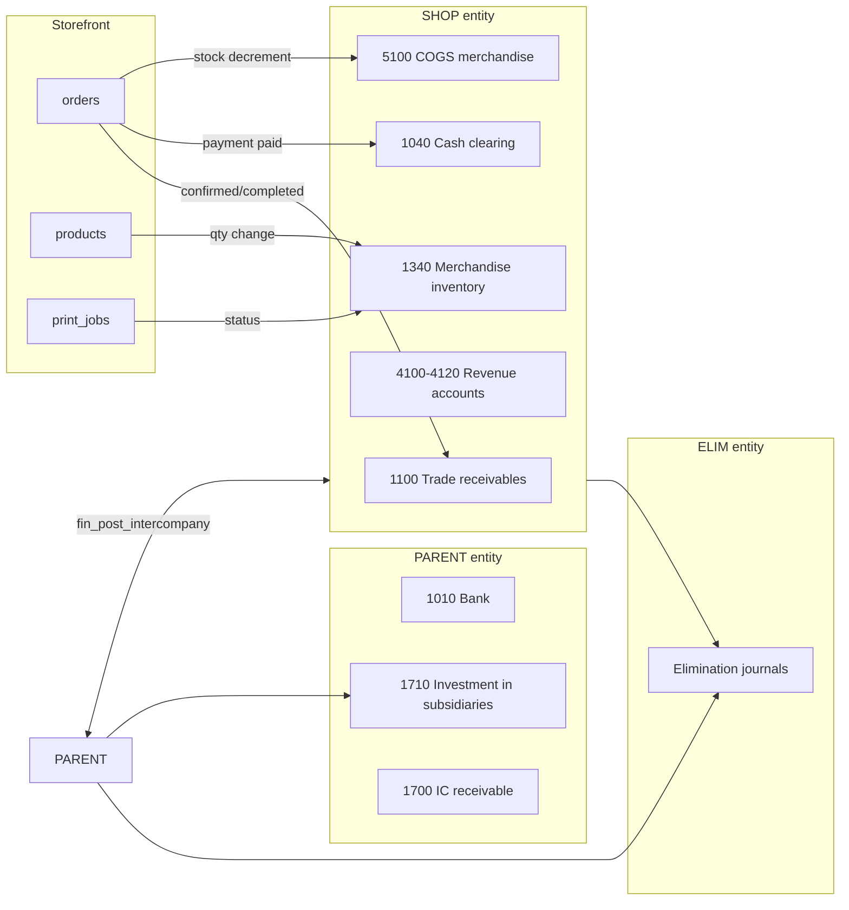

# Finance module — money flow and close process

Knight Watts Auto Parts uses multi-entity double-entry bookkeeping in Supabase (`fin_*` tables). Operational storefront data posts to the **SHOP** subsidiary via `fin_settings.shop_entity_id`. **PARENT** holds group balances and investments; **ELIM** is the consolidation elimination book (not a legal entity).

## Money flow (SHOP vs PARENT vs ELIM)

- **SHOP** — storefront AR, cash clearing, merchandise COGS/inventory, payroll, bank feeds.
- **PARENT** — group bank, investment in subsidiary (1710), IC trading balances (1700/2700), eliminations target.
- **ELIM** — technical entity for consolidation adjustments; included in `p_scope = 'consolidated'` reports with reporting members.

## Posting map (auto triggers)

| Source | When | SHOP accounts (typical) |
|--------|------|-------------------------|
| `orders` | `status` → `confirmed` / `completed` | Dr 1100; Cr 4100 (online), 4110 (attributed rep), 4120 (consumables/filament); Cr 4140 for `shipping_kes` |
| `orders` | `payment_status` → `paid` | Dr **1040** cash clearing, Cr 1100 |
| `orders` | stock decrement setting | Dr 5100, Cr 1340 — `MISSING_COST` audit only when unit cost is zero (no zero-line journal) |
| `products` | `stock_quantity` change | Dr/Cr inventory vs expense (skip if `kw.fin_internal_stock` session flag) |
| `print_jobs` | `printing` / `completed` | WIP/FG placeholders — extend when costing live |
| `commission_entries` | `approved` / `paid` | Dr 6090 Cr 2150; then Dr 2150 Cr 1020 |
| `fin_run_depreciation` | period run | Dr **6400**, Cr accum dep account **code** from asset register |

Manual and subledger posts use `fin_post_entry` / subledger tables with the same idempotent `fin_source_documents` key.

## Roles and access

- **Read:** `cfo`, `ceo`, `owner` (`fin_can_read()`).
- **Write:** `cfo` only (`fin_can_write()`). Owner and CEO are read-only in the admin finance UI.
- CEO payslip detail gated by `fin_settings.ceo_can_view_payslips`.
- RLS is role-based only (no per-entity RLS).

## Period close (recommended order)

1. **SHOP** — reconcile bank (`fin_bank_lines`), AR/AP subledgers (`fin_invoices` / `fin_bills`), inventory/FIFO, payroll drafts, post recurring templates.
2. **PARENT** — bank, IC balances vs subsidiary, manual adjustments.
3. **Soft-close** periods (`fin_periods.status` → `soft_closed`) per entity; CFO reviews `fin_insights` / `fin_data_health`.
4. **ELIM** — run `fin_propose_eliminations(p_group_id, p_period_end)` (drafts only), post elimination journals via `fin_post_elimination` after review.
5. **Consolidated** — `fin_report_tb` / SCI / SOFP with `p_scope = 'consolidated'` and `p_group_id` from `fin_settings.default_group_id`; compare to `fin_seed_expected` when populated in test environments.
6. **Hard-close** entity periods, then group sign-off.

Close each **entity** first, then **eliminations**, then **consolidated** reporting/sign-off.

## Key RPCs

- Posting: `fin_post_entry`, `fin_reverse_entry`, `fin_post_intercompany`, `fin_post_elimination`.
- Reports: `fin_report_tb`, `fin_report_gl`, `fin_report_sci`, `fin_report_sofp`, `fin_report_cf`, `fin_report_equity`, `fin_report_notes`, `fin_report_aged_ar`, `fin_report_aged_ap`, `fin_report_worksheet`, `fin_report_ratios`.
- Advisor: `fin_insights(p_scope, p_entity_id, p_group_id)`, `fin_data_health`, `fin_trace(p_ref)`, `fin_propose_eliminations(p_group_id, p_period_end)`.

Admin UI resolves entity codes (`SHOP`, `PARENT`, `consolidated`) to `p_scope` / UUIDs via `fin_entities` and `fin_settings`.

## Migrations

Apply in order:

1. `20261126120000_fin_enums.sql`
2. `20261126120001_fin_entities_groups_settings.sql`
3. `20261126120002_fin_core_journals.sql`
4. `20261126120003_fin_coa_clone_and_seed.sql`
5. `20261126120004_fin_subledgers.sql`
6. `20261126120005_fin_inventory_far_payroll.sql`
7. `20261126120006_fin_rls.sql`
8. `20261126120007_fin_reports_insights.sql`
9. `20261126120008_fin_auto_post_triggers.sql`
10. `20261126120009_fin_seed_from_sources.sql`
11. `20261126120011_fin_posting_and_reports_fix.sql`

SQL regression tests live in `supabase/tests/fin_core_tests.sql` (not auto-applied). `fin_seed_from_sources()` is defined in `20261126120009` but **must not** run during migrate on production.