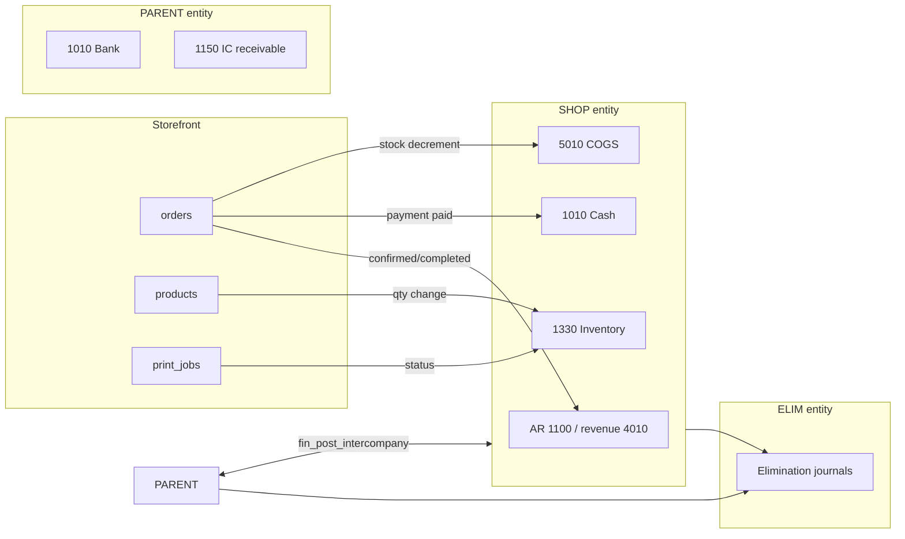

# Finance module — money flow and close process

Knight Watts Auto Parts uses multi-entity double-entry bookkeeping in Supabase (`fin_*` tables). Operational storefront data posts to the **SHOP** subsidiary via `fin_settings.shop_entity_id`. **PARENT** holds group balances and investments; **ELIM** is the consolidation elimination book (not a legal entity).

## Money flow (high level)

- **Payments (`fin_payments`)** never transmit funds; they move `draft → approved → paid` and export CSV for external banking.
- **Journals** are always single-entity; lines must use accounts from that entity.
- **Intercompany** uses shared `ic_link_id` with paired entries in one transaction (`fin_post_intercompany`).

## Posting map (auto triggers)

| Source | When | SHOP accounts (typical) |
|--------|------|-------------------------|
| `orders` | `status` → `confirmed` / `completed` | Dr 1100, Cr 4010 |
| `orders` | `payment_status` → `paid` | Dr 1010, Cr 1100 |
| `orders` | stock decrement setting | Dr 5010, Cr 1330 (0 + `MISSING_COST` if no cost) |
| `products` | `stock_quantity` change | Dr/Cr 1330 vs 5110 (skip if `kw.fin_internal_stock` session flag) |
| `print_jobs` | `printing` / `completed` | WIP/FG zero placeholders → extend when costing live |
| `commission_entries` | `approved` / `paid` | Dr 6010, Cr 2030 |

Manual and subledger posts use `fin_post_entry` / subledger tables with the same idempotent `fin_source_documents` key.

## Roles and access

- **Read:** `cfo`, `ceo`, `owner` (`fin_can_read()`).
- **Write:** `cfo` only (`fin_can_write()` — not `is_finance_staff` / `is_owner_or_admin`).
- CEO payslip detail gated by `fin_settings.ceo_can_view_payslips`.
- RLS is role-based only (no per-entity RLS).

## Period close (recommended order)

1. **SHOP** — reconcile bank (`fin_bank_lines`), AR/AP subledgers, inventory/FIFO, payroll drafts, post recurring templates.
2. **PARENT** — bank, IC balances vs subsidiary, manual adjustments.
3. **Soft-close** periods (`fin_periods.status` → `soft_closed`) per entity; CFO reviews `fin_insights` / `fin_data_health`.
4. **ELIM** — run `fin_propose_eliminations` (drafts only), post elimination journals via `fin_post_elimination` after review.
5. **Consolidated** — `fin_report_tb` / SCI / SOFP with `p_scope = 'consolidated'`; compare to `fin_seed_expected` when populated in test environments.
6. **Hard-close** entity periods, then group sign-off.

## Key RPCs

- Posting: `fin_post_entry`, `fin_reverse_entry`, `fin_post_intercompany`, `fin_post_elimination`.
- Reports: `fin_report_tb`, `fin_report_gl`, `fin_report_sci`, `fin_report_sofp`, `fin_report_cf`, `fin_report_equity`, `fin_report_notes`, aged AR/AP, worksheet, ratios.
- Advisor: `fin_insights`, `fin_data_health`, `fin_trace`, `fin_propose_eliminations`.

## Migrations

Applied in order `20261126120000` … `20261126120009`. SQL regression tests live in `supabase/tests/fin_core_tests.sql` (not auto-applied). `fin_seed_from_sources()` is defined in `20261126120009` but **must not** run during migrate.